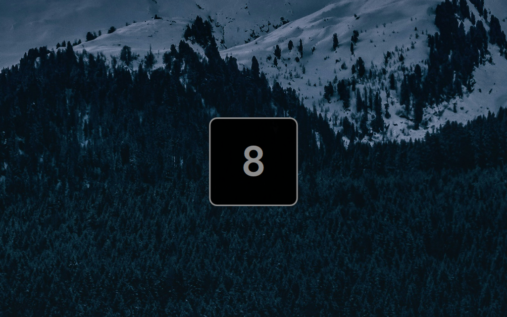

# omanum

[English](README.md) · **Русский**

Небольшой плагин для оболочки [Omarchy](https://omarchy.org/): при переключении воркспейса на экране на мгновение появляется его номер.



Когда меняется активный воркспейс, снизу экрана всплывает карточка с его номером. Если продолжаешь переключаться, цифра уезжает влево или вправо в зависимости от направления, а потом карточка сама прячется. Она в цветах текущей темы и не мешает кликам.

## Возможности

- **Цвета из темы:** фон, рамка и акцентный цвет берутся из активной темы Omarchy.
- **Анимация с учётом направления:** новый номер въезжает справа, когда идёшь вперёд, и слева, когда назад. Переход с последнего воркспейса на первый тоже считается «вперёд».
- **Домашний воркспейс:** именованный воркспейс, например `home`, показывается иконкой домика.
- **Именованные воркспейсы** показываются по имени, уменьшенному под размер карточки.
- **Не срабатывает зря:** скретчпады (special-воркспейсы) и запуск оболочки карточку не вызывают.
- **Несколько мониторов:** карточка появляется на том мониторе, где фокус.
- **Клики проходят насквозь:** слой не перехватывает ни мышь, ни клавиатуру.
- **Настраивается:** позиция, размер, время показа, анимации и иконка дома, всё меняется на лету через `shell.json`.

## Требования

- Omarchy с `omarchy-shell`.
- Hyprland.
- Nerd Font для иконки домика. В Omarchy по умолчанию стоит JetBrainsMono Nerd Font.

## Установка

### Через git

```bash
omarchy plugin add https://github.com/miruken1207/omanum.git --enable
```

Как и любой сторонний плагин, omanum работает внутри `omarchy-shell` без песочницы. Перед включением загляни в код: там около 400 строк.

### Вручную

```bash
git clone https://github.com/miruken1207/omanum.git ~/.config/omarchy/plugins/miruken1207.omanum
omarchy plugin enable miruken1207.omanum
```

### Рекомендуется: отключить fade-анимацию Hyprland для слоя

omanum анимирует себя сам. Стандартная fade-анимация Hyprland для слоёв накладывается поверх, и карточка выглядит смазанной. Добавь в `~/.config/hypr/hyprland.lua`:

```lua
hl.layer_rule({ match = { namespace = "^miruken1207-omanum$" }, no_anim = true, animation = "none" })
```

## Настройки

Настройки задаются прямо в записи плагина в `~/.config/omarchy/shell.json` и применяются сразу после сохранения:

```json
{
  "plugins": [
    {
      "id": "miruken1207.omanum",
      "position": "bottom",
      "size": 112,
      "duration": 1000
    }
  ]
}
```

| Ключ | По умолчанию | Описание |
|---|---|---|
| `duration` | `1000` | Сколько миллисекунд карточка висит после последнего переключения (200–5000). |
| `position` | `"bottom"` | `"bottom"`, `"center"` или `"top"`. |
| `offset` | `140` | Отступ от края экрана (0–1000). Не учитывается при `center`. По умолчанию карточка стоит выше OSD громкости и яркости. |
| `size` | `112` | Размер карточки (48–320). |
| `homeWorkspace` | `"home"` | Имя воркспейса, который показывается домиком. `""` отключает домик. |
| `homeIcon` | домик | Любой текст или иконка вместо домика. |
| `lastWorkspace` | `10` | Номер последнего воркспейса. Переход с него на первый (или на home) анимируется как «вперёд». |
| `animations` | `true` | `false`: карточка появляется и исчезает мгновенно. |
| `animationSpeed` | `"normal"` | `"slow"`, `"normal"` или `"fast"`. |

Неверные значения заменяются значениями по умолчанию, а числа вне диапазона приводятся к ближайшей границе.

### Пример: домашний воркспейс

Если в конфиге Hyprland есть именованный воркспейс:

```lua
o.bind("SUPER + grave", "Home workspace", hl.dsp.focus({ workspace = "name:home" }))
```

omanum показывает для него домик и считает его воркспейсом 0: `home → 1` едет вперёд, `1 → home` назад.

## Структура проекта

```
Service.qml        точка входа: следит за воркспейсом, читает настройки, решает, когда показать
OsdWindow.qml      прозрачный слой поверх экрана на мониторе с фокусом, клики проходят насквозь
DigitCard.qml      карточка и все её анимации
Model.js           чистая логика без QML (настройки, подписи, направление анимации)
tests/             юнит-тесты для Model.js
```

## Разработка

Запуск тестов (нужен Node.js):

```bash
node tests/model.test.js
```

Сервисы с `keepLoaded` не перезагружаются на лету, а выключение и включение плагина берёт код из кэша. Чтобы подхватить изменения в QML-файлах, перезапусти оболочку:

```bash
omarchy restart shell
```

## Лицензия

[MIT](LICENSE)
